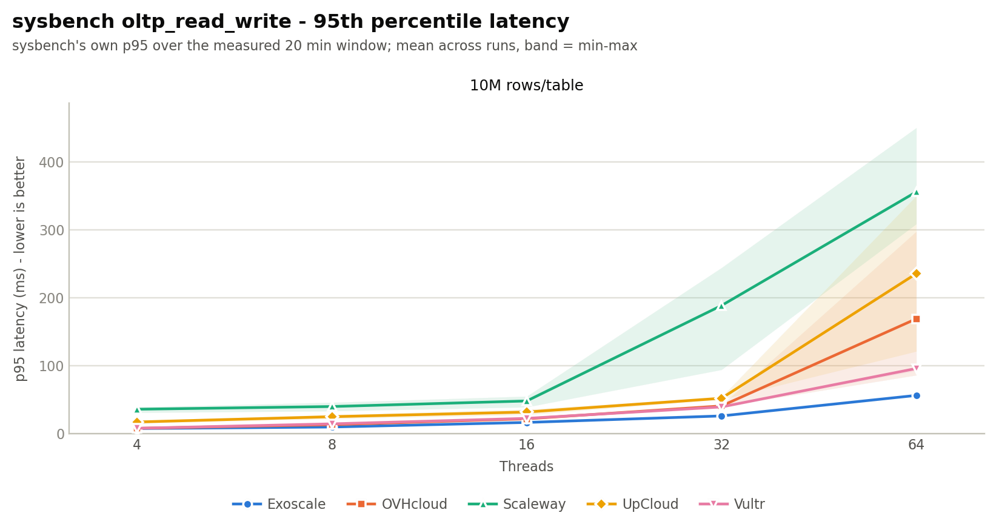
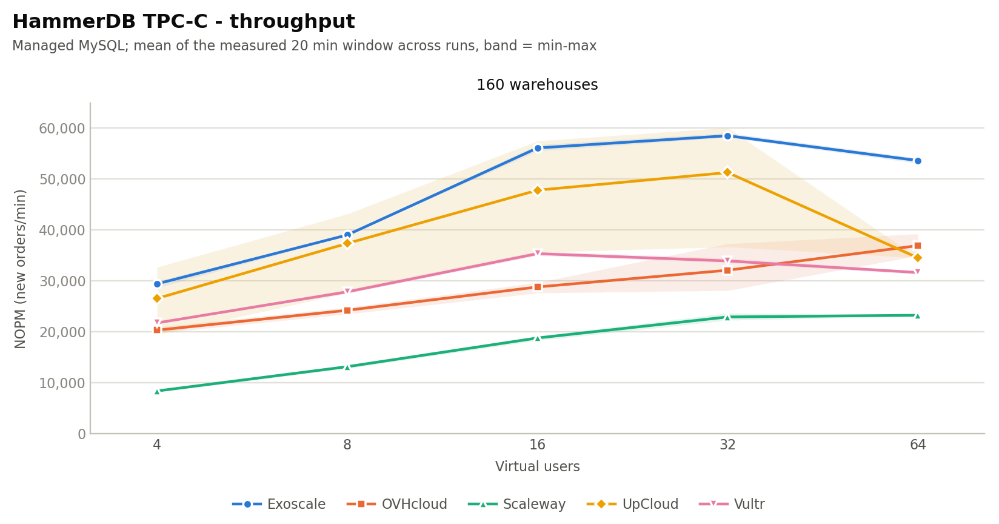

# Beyond the Hyperscalers: Managed MySQL and PostgreSQL Performance and Cost

Benchmark harness, raw results and analysis for a comparison of managed database
services (DBaaS) from non-hyperscaler cloud providers: Scaleway, UpCloud, Vultr,
OVHcloud and Exoscale.

Interactive results:
[MySQL](https://percona-lab-results.github.io/2026-cloud-nhs/analysis-mysql/)
[PostgreSQL](https://percona-lab-results.github.io/2026-cloud-nhs/analysis-pg/)

## Research objectives

This research compares non-hyperscaler cloud providers that offer MySQL DBaaS.
First, we run benchmarks on the managed MySQL services out of the box, as the
providers configured them. After that, we calculate cost efficiency using the
billing data from each provider after the benchmark runs are completed.

As a result, we determine the best-performing service in terms of raw throughput
and the service with the best cost efficiency per transaction.

The PostgreSQL services of the same providers were tested with the same method,
using `cloud-pg-perf.sh`. Their results are in `results-pg/` and `analysis-pg/`.

## DBaaS shape

The cloud shape chosen for the analysis represents a mid-level, startup-oriented
general purpose tier that can handle moderate amounts of data:

- **CPU:** 4 vCPU, shared.
- **RAM:** 16 GB, a standard configuration option for 4 vCPU.
- **Storage:** 150 to 350 GB SSD/NVMe.

### Why shared vCPUs

Dedicated vCPU services were not chosen because several providers require extra
measures before they can be used, such as government-issued ID checks,
geographic location restrictions and quotas.

## Providers and plans

| Provider | Plan / Tier                       | MySQL Version | Account Perks |
|----------|-----------------------------------|---------------|---------------|
| Scaleway | DB-PRO2-XS                        | 8.0.21        |               |
| UpCloud  | Managed Database - Standard       | 8.4.11        | $500 Credit   |
| Vultr    | Startup General Purpose Optimised | 8.4.11        | $250 Credit   |
| OVHcloud | Discovery B3-16                   | 8.4.11        |               |
| Exoscale | Startup-16                        | 8.4.11        |               |

### Why some providers were not included

- They do not offer a comparable plan (4 shared vCPU / 16 GB RAM). Linode is an
  example.
- Their managed database does not physically run on their own servers. Providers
  such as Aiven offer managed MySQL hosted on AWS, Google, DigitalOcean and
  others, so a benchmark would measure the underlying cloud rather than the
  provider.

## Benchmark client

To reduce network delays, the benchmarks were run from compute instances created
within the same cloud provider infrastructure and region as the database. The
compute instances had 4 vCPUs and 16 GB of RAM, so that the client would not
become a bottleneck.

## Workloads

**Sysbench**

- Test: `oltp_read_write`.
- 10 tables with 10, 20 or 40 million rows per table (data sets of about 16, 32
  and 64 GB).

**HammerDB**

- Test: TPC-C (TPROC-C).
- 160, 320 or 640 warehouses (data sets of about 16, 32 and 64 GB).

**Run parameters (both tools)**

- Threads / virtual users: 4, 8, 16, 32 and 64.
- Ramp-up: 5 minutes.
- Run: 20 minutes.
- Number of runs: 3. Because the vCPUs are shared, noisy neighbors can affect
  results, and repeating each run reduces that effect.
- Database rebuild: the schema is rebuilt for each iteration (each thread count).

## Metrics

- **NOPM, TPM and TPS:** the main performance metrics.
- **P95 latency:** how long the client has to wait for a reply.
- **Server variables and server status:** collected every 10 seconds for
  additional analysis.

InnoDB status was not collected, because not every provider grants the `PROCESS`
privilege.

## Hardware caveats

**CPU.** A vCPU is an abstraction and does not tell the exact hardware
specification of the physical CPU. It is possible to infer the architecture,
because providers usually distinguish between x86_64 and ARM processors when a
managed service is created. All services in this test are x86_64, but the
manufacturer (usually AMD or Intel) and the chip generation are unknown.

**Storage.** Where a provider offered a choice between block and local storage,
or between general SSD and NVMe, we chose local NVMe as the fastest option.
Storage performance varies widely across models and manufacturers, but with
managed services we rely on the providers to make those decisions. Bare-metal
and Advanced/Premium offerings with specific hardware configurations are outside
the scope of this investigation.

## Cost efficiency methodology

### Billing model

Some providers charge for the time a managed service exists, while others charge
based on the load on that service. Cost efficiency therefore is not absolute: it
depends on the real usage scenario.

All providers in this review bill for the time the managed service exists. The
cost of running a managed database instance can also include additional charges,
such as extra storage (when the base configuration does not have enough disk
space), network bandwidth and public IP addresses. The hourly costs below
include these charges.

| Provider | Cost in USD per 1 hour |
|----------|------------------------|
| Scaleway | $0.570                 |
| UpCloud  | $0.301                 |
| Vultr    | $0.429                 |
| OVHcloud | $0.490                 |
| Exoscale | $0.650                 |

### Calculation

Cost efficiency answers one question: how many database transactions can $1 buy
when the database is running at maximum efficiency?

- The transaction count excludes database initialization and ramp-up.
- It uses the peak throughput achieved across all benchmarks. Low numbers of
  connections (such as 4 or 8) do not load the database servers to saturation,
  so the peak is the fairer measure of what the service can deliver.
- The calculation assumes the managed database is working constantly and that
  periods of low activity are short.

## Out of scope

Many factors that matter when choosing a DBaaS provider were not tested. The
most important ones include:

- Region.
- Specific database software versions.
- Flexibility and frequency of backups.
- Multi-node performance.

## Graphs

Every graph is generated in a light and a dark version. The light MySQL versions
are shown below; the full set, including 20M/40M rows and 320/640 warehouses, is
in [`analysis-mysql/`](analysis-mysql/) and [`analysis-pg/`](analysis-pg/).

**Sysbench throughput, 10M rows per table**


**Sysbench peak throughput, 10M rows per table**


**Sysbench p95 latency, 10M rows per table**



**HammerDB throughput, 160 warehouses**



**Cost efficiency**


## Repository layout

| Path               | Contents                                                              |
|--------------------|-----------------------------------------------------------------------|
| `cloud-mysql-perf.sh` | Benchmark harness for managed MySQL (sysbench and HammerDB).       |
| `cloud-pg-perf.sh` | PostgreSQL counterpart of the MySQL harness, with the same test matrix. |
| `analyze_results.py` | Builds the graphs, summary CSVs and cost-efficiency figures from a results tree. |
| `html_report.py`   | Renders the aggregated data as the self-contained interactive `index.html`. |
| `results-mysql/`, `results-pg/` | Raw results, one directory per benchmark session (`<provider>-<UTC stamp>-<label>`). |
| `analysis-mysql/`, `analysis-pg/` | Generated graphs (PNG, light and dark), summary CSVs and `index.html`. |

## Reproducing the analysis

The analysis needs Python 3 with `numpy` and `matplotlib`.

```bash
python3 analyze_results.py --db MySQL -r results-mysql -o analysis-mysql
```

```bash
python3 analyze_results.py --db PostgreSQL -r results-pg -o analysis-pg
```

Run `./cloud-mysql-perf.sh --help` or `./cloud-pg-perf.sh --help` for the
benchmark harness options. Note that the harness defaults (for example the
thread list) differ from the values used in this study, which are listed under
[Workloads](#workloads).
