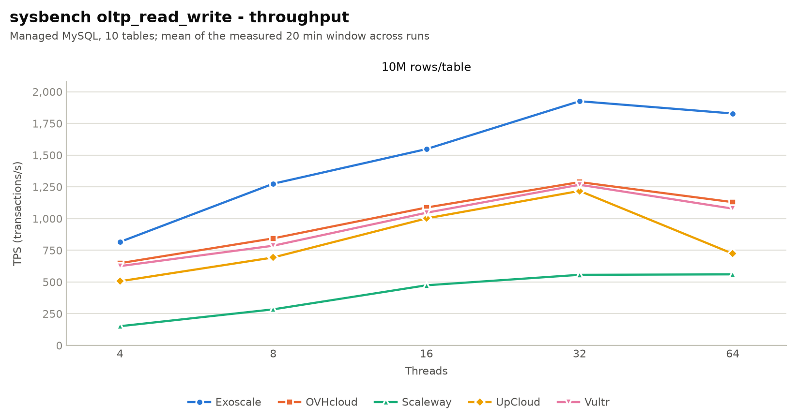
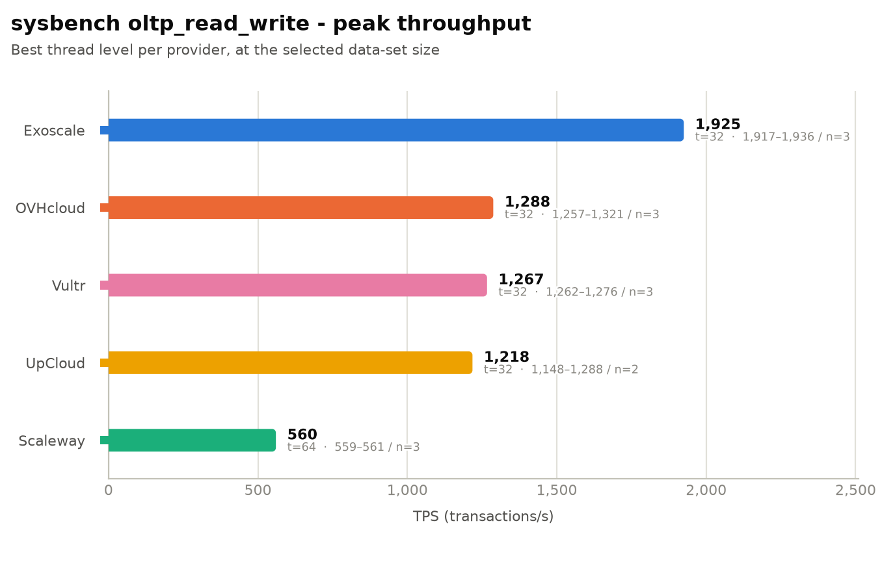
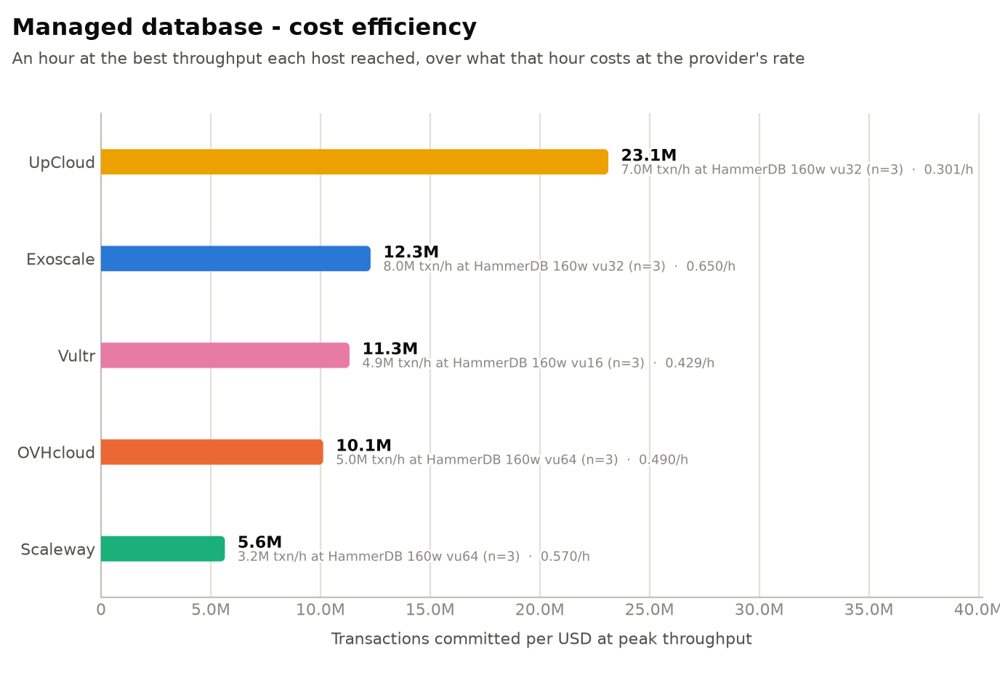

# Beyond the Hyperscalers: Managed MySQL and PostgreSQL Performance and Cost

Benchmark harness, raw results and analysis for a comparison of managed database
services (DBaaS) from non-hyperscaler cloud providers: Scaleway, UpCloud, Vultr,
OVHcloud and Exoscale.

Interactive results:
[MySQL](https://percona-lab-results.github.io/2026-cloud-nhs/analysis-mysql/)
[PostgreSQL](https://percona-lab-results.github.io/2026-cloud-nhs/analysis-pg/)

## Research objectives

This research compares non-hyperscaler cloud providers that offer MySQL DBaaS.
First, we run benchmarks on the managed MySQL services out of the box, as the
providers configured them. After that, we calculate cost efficiency using the
billing data from each provider after the benchmark runs are completed.

As a result, we determine the best-performing service in terms of raw throughput
and the service with the best cost efficiency per transaction.

The PostgreSQL services of the same providers were tested with the same method,
using `cloud-pg-perf.sh`. Their results are in `results-pg/` and `analysis-pg/`.

## DBaaS shape

The cloud shape chosen for the analysis represents a mid-level, startup-oriented
general purpose tier that can handle moderate amounts of data:

- **CPU:** 4 vCPU, shared.
- **RAM:** 16 GB, a standard configuration option for 4 vCPU.
- **Storage:** 150 to 350 GB SSD/NVMe.

### Why shared vCPUs

Dedicated vCPU services were not chosen because several providers require extra
measures before they can be used, such as government-issued ID checks,
geographic location restrictions and quotas.

## Providers and plans

| Provider | Plan / Tier                       | MySQL Version | Account Perks |
|----------|-----------------------------------|---------------|---------------|
| Scaleway | DB-PRO2-XS                        | 8.0.21        |               |
| UpCloud  | Managed Database - Standard       | 8.4.11        | $500 Credit   |
| Vultr    | Startup General Purpose Optimised | 8.4.11        | $250 Credit   |
| OVHcloud | Discovery B3-16                   | 8.4.11        |               |
| Exoscale | Startup-16                        | 8.4.11        |               |

### Why some providers were not included

- They do not offer a comparable plan (4 shared vCPU / 16 GB RAM). Linode is an
  example.
- Their managed database does not physically run on their own servers. Providers
  such as Aiven offer managed MySQL hosted on AWS, Google, DigitalOcean and
  others, so a benchmark would measure the underlying cloud rather than the
  provider.

## Benchmark client

To reduce network delays, the benchmarks were run from compute instances created
within the same cloud provider infrastructure and region as the database. The
compute instances had 4 vCPUs and 16 GB of RAM, so that the client would not
become a bottleneck.

## Workloads

**Sysbench**

- Test: `oltp_read_write`.
- 10 tables with 10, 20 or 40 million rows per table (data sets of about 16, 32
  and 64 GB).

**HammerDB**

- Test: TPC-C (TPROC-C).
- 160, 320 or 640 warehouses (data sets of about 16, 32 and 64 GB).

**Run parameters (both tools)**

- Threads / virtual users: 4, 8, 16, 32 and 64.
- Ramp-up: 5 minutes.
- Run: 20 minutes.
- Number of runs: 3. Because the vCPUs are shared, noisy neighbors can affect
  results, and repeating each run reduces that effect.
- Database rebuild: the schema is rebuilt for each iteration (each thread count).

## Metrics

- **NOPM, TPM and TPS:** the main performance metrics.
- **P95 latency:** how long the client has to wait for a reply.
- **Server variables and server status:** collected every 10 seconds for
  additional analysis.

InnoDB status was not collected, because not every provider grants the `PROCESS`
privilege.

## Hardware caveats

**CPU.** A vCPU is an abstraction and does not tell the exact hardware
specification of the physical CPU. It is possible to infer the architecture,
because providers usually distinguish between x86_64 and ARM processors when a
managed service is created. All services in this test are x86_64, but the
manufacturer (usually AMD or Intel) and the chip generation are unknown.

**Storage.** Where a provider offered a choice between block and local storage,
or between general SSD and NVMe, we chose local NVMe as the fastest option.
Storage performance varies widely across models and manufacturers, but with
managed services we rely on the providers to make those decisions. Bare-metal
and Advanced/Premium offerings with specific hardware configurations are outside
the scope of this investigation.

## Cost efficiency methodology

### Billing model

Some providers charge for the time a managed service exists, while others charge
based on the load on that service. Cost efficiency therefore is not absolute: it
depends on the real usage scenario.

All providers in this review bill for the time the managed service exists. The
cost of running a managed database instance can also include additional charges,
such as extra storage (when the base configuration does not have enough disk
space), network bandwidth and public IP addresses. The hourly costs below
include these charges.

| Provider | Cost in USD per 1 hour |
|----------|------------------------|
| Scaleway | $0.570                 |
| UpCloud  | $0.301                 |
| Vultr    | $0.429                 |
| OVHcloud | $0.490                 |
| Exoscale | $0.650                 |

### Calculation

Cost efficiency answers one question: how many database transactions can $1 buy
when the database is running at maximum efficiency?

- The transaction count excludes database initialization and ramp-up.
- It uses the peak throughput achieved across all benchmarks. Low numbers of
  connections (such as 4 or 8) do not load the database servers to saturation,
  so the peak is the fairer measure of what the service can deliver.
- The calculation assumes the managed database is working constantly and that
  periods of low activity are short.

## Out of scope

Many factors that matter when choosing a DBaaS provider were not tested. The
most important ones include:

- Region.
- Specific database software versions.
- Flexibility and frequency of backups.
- Multi-node performance.

## Graphs

Every graph is generated in a light and a dark version. The light MySQL versions
are shown below; the full set, including 20M/40M rows and 320/640 warehouses, is
in [`analysis-mysql/`](analysis-mysql/) and [`analysis-pg/`](analysis-pg/).

**Sysbench throughput, 10M rows per table**



**Sysbench peak throughput, 10M rows per table**



**Sysbench p95 latency, 10M rows per table**


**HammerDB throughput, 160 warehouses**


**Cost efficiency**



## Repository layout

| Path               | Contents                                                              |
|--------------------|-----------------------------------------------------------------------|
| `cloud-mysql-perf.sh` | Benchmark harness for managed MySQL (sysbench and HammerDB).       |
| `cloud-pg-perf.sh` | PostgreSQL counterpart of the MySQL harness, with the same test matrix. |
| `analyze_results.py` | Builds the graphs, summary CSVs and cost-efficiency figures from a results tree. |
| `html_report.py`   | Renders the aggregated data as the self-contained interactive `index.html`. |
| `results-mysql/`, `results-pg/` | Raw results, one directory per benchmark session (`<provider>-<UTC stamp>-<label>`). |
| `analysis-mysql/`, `analysis-pg/` | Generated graphs (PNG, light and dark), summary CSVs and `index.html`. |

## Reproducing the analysis

The analysis needs Python 3 with `numpy` and `matplotlib`.

```bash
python3 analyze_results.py --db MySQL -r results-mysql -o analysis-mysql
```

```bash
python3 analyze_results.py --db PostgreSQL -r results-pg -o analysis-pg
```

The harness options are described under [Benchmark harness](#benchmark-harness)
below. Note that the harness defaults (for example the thread list) differ from
the values used in this study, which are listed under [Workloads](#workloads).

## Benchmark harness

Two drivers, same matrix, same output layout, so MySQL and PostgreSQL tiers of
the same provider are directly comparable:

* [cloud-mysql-perf.sh](cloud-mysql-perf.sh) - managed MySQL
* [cloud-pg-perf.sh](cloud-pg-perf.sh) - managed PostgreSQL

### cloud-mysql-perf.sh

OLTP benchmark driver for a managed MySQL endpoint. Sweeps the thread matrix
once per data-set size, repeats everything N times, and collects the
server-side state around every run. The defaults are:

| | sysbench | HammerDB |
|---|---|---|
| workload | `oltp_read_write` | TPC-C (TPROC-C) |
| data sets | 10 tables x 10M / 20M / 40M rows per table | 160 / 320 / 640 warehouses |
| load levels | 1, 2, 4, 8 threads | 1, 2, 4, 8 virtual users |
| ramp-up | 5 min, discarded | 5 min (`mysql_rampup`) |
| measured | 20 min | 20 min (`mysql_duration`) |
| metric | tps / qps / latency incl. p95 | NOPM / TPM |

The data-set size is the outer dimension of each sweep (`--table-size`,
`--warehouses`; both accept a list, `K`/`M` suffixes allowed), so the point of
the exercise - how a tier behaves as the data grows past its buffer pool - is
one column of the CSVs.

Loading granularity is `--rebuild`:

| `--rebuild` | reload | rebuilds with the defaults |
|---|---|---|
| `run` (default) | before every measured run | 72 |
| `dataset` | once per data set and run, then sweep the thread levels | 18 |
| `never` (`--skip-prepare`) | reuse whatever is loaded | 0 |

Defaults: 3 runs x 3 data sets x 4 load levels x 2 benchmarks = 72
configurations ~ 30 h of measured time, and the default `--rebuild run` adds a
full load of up to 400M rows / 640 warehouses before each of them. For a
realistic schedule use `--rebuild dataset`, or cut `--runs` / `--threads`.
Runs form the outer loop, so an interrupted session still contains complete
passes over every data set.

#### Usage

`--provider`, `--host` and `--user` are mandatory, as is a password
(`--password`, `--password-file` or `MYSQL_PWD`).

```bash
./cloud-mysql-perf.sh --provider digitalocean \
    -H db.example.com -P 25060 -u doadmin -p 'secret' --label 2vcpu-4gb

./cloud-mysql-perf.sh --provider linode -H db.example.com -u admin \
    --password-file ~/.pw --runs 1 -t "1 8" -b sysbench \
    --table-size 10M --rebuild dataset            # one data set, one pass
./cloud-mysql-perf.sh --provider hetzner -H ... -n # dry run, print the plan
./cloud-mysql-perf.sh --help                       # all options
```

Useful flags: `--runs`, `--threads`, `--rampup`, `--duration`, `--benchmarks`,
`--table-size`, `--warehouses`, `--rebuild`, `--prepare-only`,
`--cleanup-after`, `--ssl`, `--sample-interval`, `--innodb-status`.

Credentials are written to 0600 option files in a private temp directory and
passed to `mysql`/`sysbench` via `--defaults-extra-file` / `--config-file`, so
they never appear in the process list. HammerDB needs the password inside its
Tcl script, so that script is kept in the temp directory and only a redacted
copy plus scrubbed logs are written to the results directory.

#### Results layout

The provider names the results directory and prefixes every file inside it, and
it is the first column of both CSVs - so results from several providers can be
dropped into one directory or concatenated without losing their origin. The
scripts write to `results/` by default; in this repository the sessions were
moved to `results-mysql/` and `results-pg/`.

```
results/<provider>-<UTC timestamp>-<label>/
  <provider>_config.txt             provider, parameters, client versions, estimate
  <provider>_summary.txt            means per data set and load level
  <provider>_run.log
  <provider>_sysbench_results.csv   provider,benchmark,run,tables,
                                    rows_per_table,threads,...,tps,qps,
                                    lat_min/avg/p95/max,errors
  <provider>_hammerdb_results.csv   provider,benchmark,run,warehouses,vu,
                                    nopm,tpm,status
  sysbench/                         full sysbench output + prepare log per run
  hammerdb/                         per-run tcl + hammerdbcli log, VU log,
                                    xtprof, and the schema build log per run
  server/
    <provider>_variables_{baseline,final}.tsv
    <provider>_status_<phase>.tsv         SHOW GLOBAL STATUS before/after each run
    <provider>_status_delta_<phase>.tsv   counters that moved during the run
    <provider>_samples_<phase>.tsv        key counters every --sample-interval sec
    <provider>_innodb_status_<phase>.txt  only with --innodb-status
    <provider>_server_info.txt            version, buffer pool, isolation, sizes
    <provider>_server_info_<dataset>.txt  on-disk size of each loaded data set
```

Phase tags carry the data set, so every artifact is attributable:
`sysbench_r2_s20M_t4`, `hammerdb_r2_w320_vu4`.

Comparing providers is then just:

```bash
awk 'FNR>1 || NR==1' results-mysql/*/*_sysbench_results.csv > all_sysbench.csv
```

#### Notes for managed services

* The benchmark user needs `CREATE` on both schemas and `DROP` for the rebuild
  between runs; without `DROP DATABASE` the script falls back to
  `sysbench cleanup` / HammerDB `deleteschema`.
* `SHOW ENGINE INNODB STATUS` is not collected unless `--innodb-status` is
  given - it needs `PROCESS`, which managed services often withhold (the script
  warns and continues when it is denied).
* HammerDB creates stored procedures by default. With binary logging on and
  `log_bin_trust_function_creators=OFF` that fails without `SUPER`; in that case
  build the schema with `--no-stored-procs yes`, or let the server decide with
  `--no-stored-procs auto`.
* HammerDB connects over the unix socket whenever the host is
  `localhost`/`127.0.0.1` - use the routable address, or pass `--socket`.
* Schema builds dominate the wall clock at these sizes. `--build-vu` (default
  16, capped at the warehouse count) is what makes a 640-warehouse load
  tolerable; raise it only as far as the tier's `max_connections` allows.
* Check that the tier has the disk space for the largest data set before
  starting - 10x40M sysbench rows is roughly 100 GB, 640 warehouses ~64 GB, and
  both schemas exist side by side.
* sysbench's measured window is produced with `--report-checkpoints`, which
  resets the counters at the end of the ramp-up; the connections are never
  dropped, so the 25 minutes are one continuous run.
* Run the client close to the database (same region) - otherwise round-trip
  time, not the database tier, is what gets measured.

### cloud-pg-perf.sh

The PostgreSQL counterpart: same benchmarks (`sysbench oltp_read_write` through
sysbench's `pgsql` driver, HammerDB TPROC-C with `dbset db pg`), same data sets,
thread levels, ramp-up/duration, `--rebuild` semantics, provider prefixing and
CSV columns, so the two scripts' results can be compared column by column.

```bash
./cloud-pg-perf.sh --provider digitalocean \
    -H db.example.com -P 25060 -u doadmin -p 'secret' \
    --maintenance-db defaultdb --ssl --label 2vcpu-4gb

./cloud-pg-perf.sh --provider linode -H db.example.com -u admin \
    --password-file ~/.pw --runs 1 -t "1 8" -b sysbench \
    --table-size 10M --rebuild dataset
./cloud-pg-perf.sh --help
```

Requirements: `postgresql-client` (for `psql`) and a sysbench built with the
`pgsql` driver - the Ubuntu package is, and `sysbench --help` lists the
compiled-in drivers. HammerDB 6.0 ships its PostgreSQL library inside the
binary, so no extra Tcl package is needed.

What differs from the MySQL script:

| | MySQL | PostgreSQL |
|---|---|---|
| credentials | 0600 `--defaults-extra-file` | 0600 `PGPASSFILE` + `PG*` env vars |
| TLS | `--ssl` | `--ssl` (`sslmode=require`), `--ssl-ca FILE` (`verify-ca`) |
| admin connection | any schema | `--maintenance-db` (default `postgres`, DO uses `defaultdb`) |
| settings | `SHOW GLOBAL VARIABLES` | `pg_settings` |
| counters | `SHOW GLOBAL STATUS` | `pg_stat_database`/`_bgwriter`/`_wal`/`_checkpointer`/`_io`, melted to name/value pairs |
| deep dive | `--innodb-status` | `--detail-stats` (`pg_stat_activity`, `pg_locks`, `pg_stat_user_tables`) |
| stored procedures | `--no-stored-procs` (default no) | `--stored-procs yes\|no` (default no) |
| after a load | - | `VACUUM ANALYZE` (and HammerDB `pg_vacuum`), off with `--no-vacuum` |

Extra notes:

* The benchmark user needs `CREATEDB`; the rebuild uses
  `DROP DATABASE ... WITH (FORCE)` and falls back to terminating the backends,
  then to `sysbench cleanup` / HammerDB `deleteschema`. The preflight warns when
  `CREATEDB` is missing.
* A fresh load has no visibility map and no statistics, so `VACUUM ANALYZE`
  after loading is on by default - without it the first run of a data set
  measures different plans and hint-bit writes rather than the tier.
* Counter views come and went across versions (`pg_stat_wal` 14,
  `pg_stat_io` 16, `pg_stat_checkpointer` 17). The preflight drops the ones this
  server lacks and says so; everything else is collected as name/value pairs, so
  column churn does not break the deltas.
* `--tpcc-user` defaults to the connection user, so no role has to be created on
  a managed service; HammerDB creates the `tpcc` database itself.
* The `errors` column of the sysbench CSV counts ignored errors, which on
  PostgreSQL are mostly serialization/deadlock retries. They are common on small
  data sets with several threads and should be near zero at 10M+ rows - if not,
  the number belongs in the write-up.
* `pg_stat_ssl` is logged at preflight, so the results record whether the run
  was actually encrypted.
